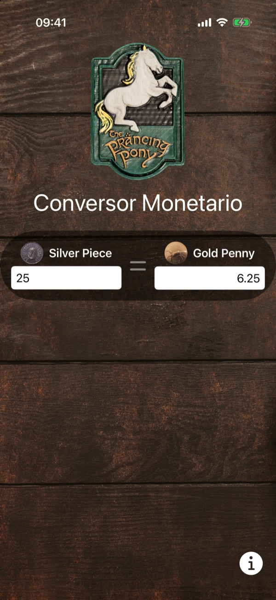
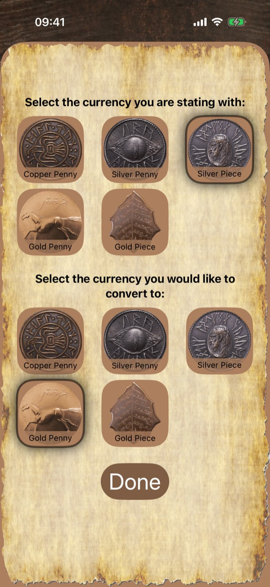
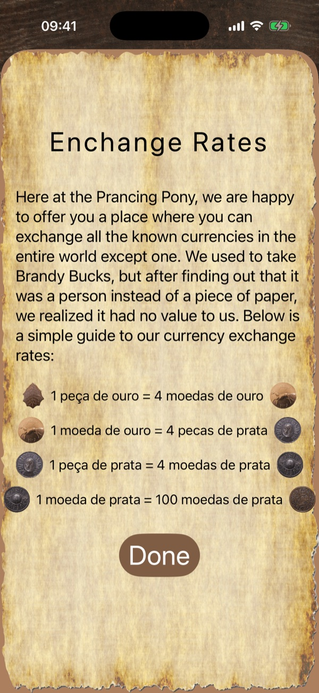

# SwiftUI Course Projects

Projects I built while taking a SwiftUI course on Udemy. The code comments include my own study notes (in Portuguese) about the concepts covered in each lesson.

<p>
  
  
  
</p>

## Projects

### 🪙 Currency Converter (`swift_ui/swiftui/ConvertorMonetario`)

A fantasy-themed currency exchange for the *Prancing Pony* inn: convert between copper pennies, silver pennies, silver pieces, gold pennies and gold pieces.

<p align="center">
  
  &nbsp;
  
  &nbsp;
  
</p>

- Two-way conversion: typing in either field updates the other in real time
- Currency picker sheet with a grid of coins for the "from" and "to" currencies
- Exchange rates screen explaining how each coin converts to the next
- Selected currencies saved with `UserDefaults`
- An onboarding hint built with **TipKit**

**Concepts practiced:** `@State`, `@Binding`, `@FocusState`, `@Environment(\.dismiss)`, sheets, `LazyVGrid`, enums with `CaseIterable` and raw values, asset symbols (`ImageResource`) and modifier order.

## Running a project

1. Clone the repository:
   ```bash
   git clone https://github.com/filizzolalucca/udemy.git
   ```
2. Open the project's `.xcodeproj` (for example `swift_ui/swiftui/ConvertorMonetario/ConvertorMonetario.xcodeproj`) in Xcode 26 or later.
3. Pick a simulator and press **⌘R**.

## Author

**Lucca Filizzola** · [@filizzolalucca](https://github.com/filizzolalucca)
